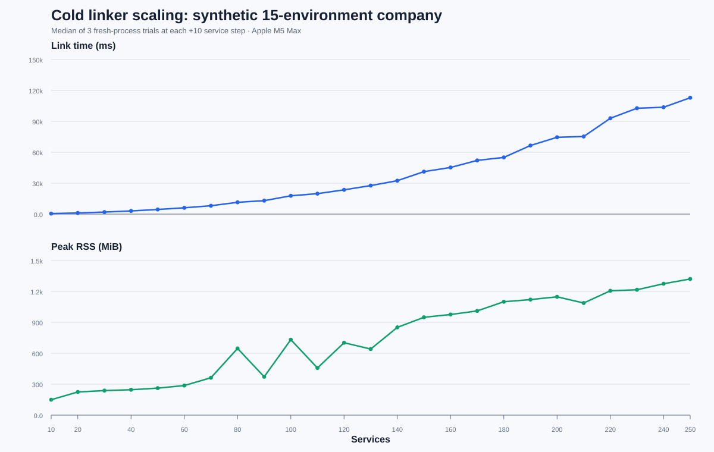
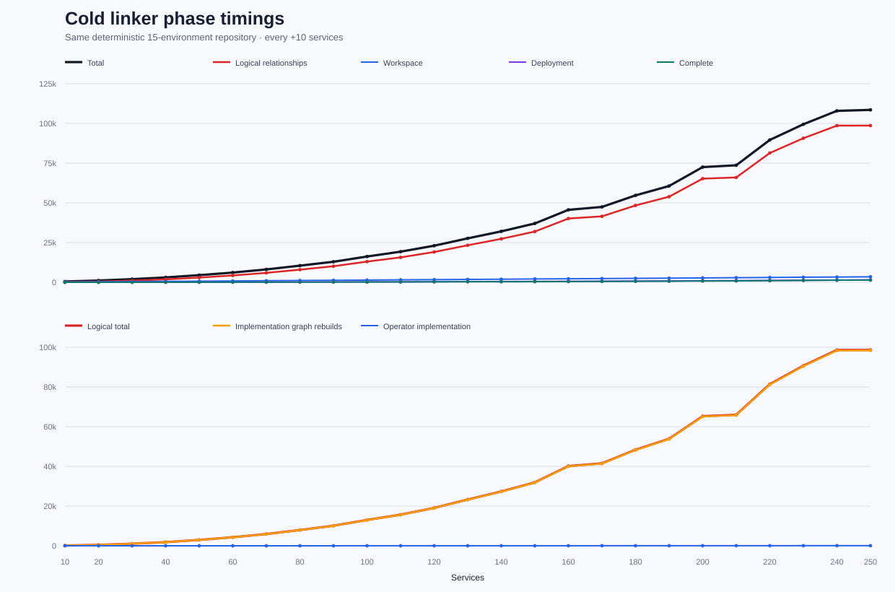
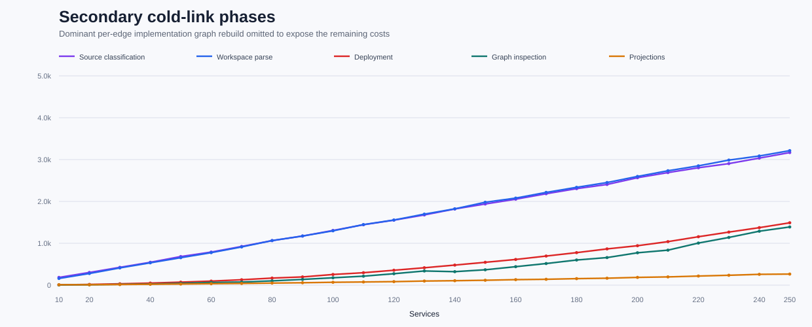
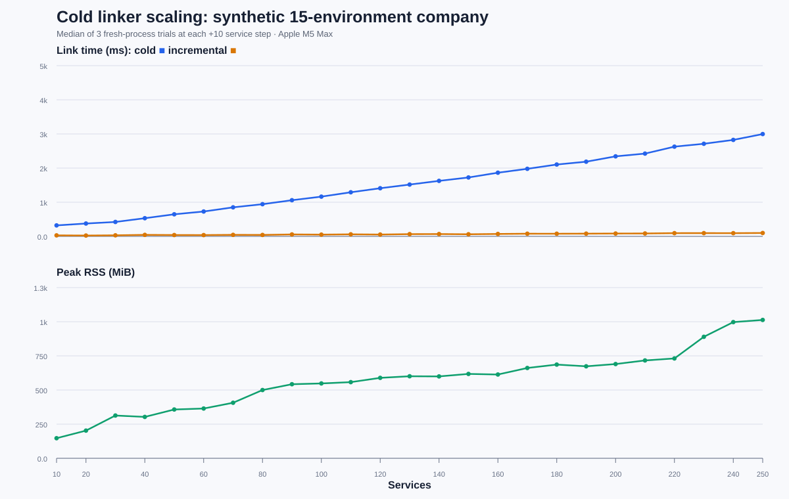
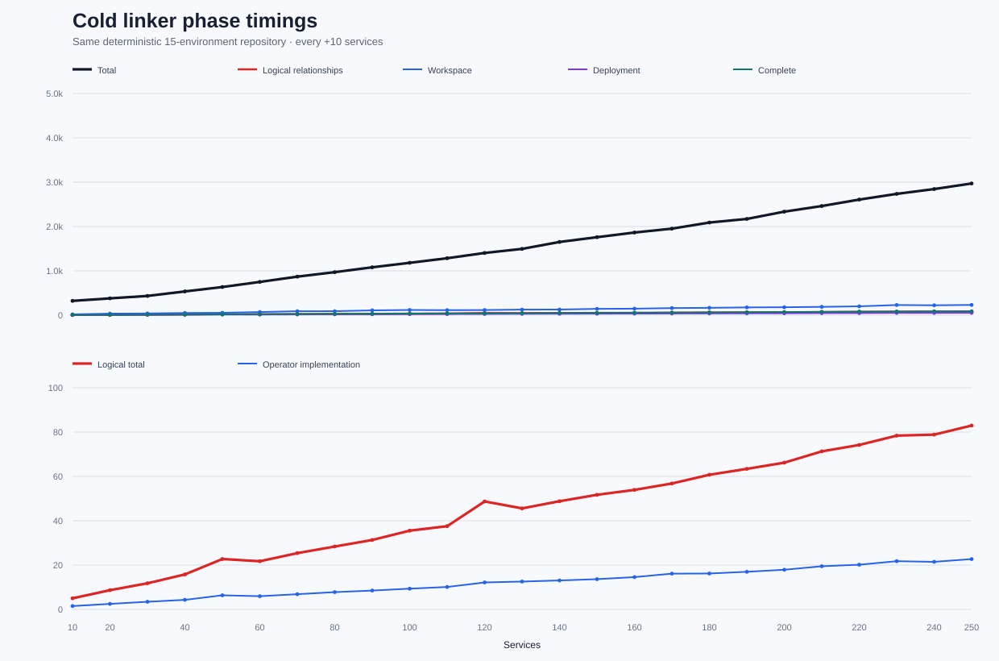

# Archinsight linker scaling investigation

## Workload

The deterministic benchmark repository models 250 business services in 39
bounded contexts of 3–10 services and 15 deployment environments. Every
service has three containers, 24 C3 components, two deployment profiles, and
both intra-context and cross-context relationships.

At full scale it contains 1,016 Insight sources, 71,578 source lines, 7,590
linked elements, and 10,204 final linked edges. All measured sizes link with
zero diagnostics.

## Cold-link scaling

The baseline uses three fresh Node.js processes at every +10 service point.
Source reads and module startup are excluded. Median cold-link time grows from
506 ms at 10 services to 112.9 s at 250 services.

| Services | Sources | Elements | Edges | Median cold link |
| ---: | ---: | ---: | ---: | ---: |
| 10 | 56 | 390 | 398 | 0.51 s |
| 50 | 216 | 1,590 | 2,030 | 4.49 s |
| 100 | 416 | 3,090 | 4,073 | 17.78 s |
| 150 | 616 | 4,590 | 6,117 | 41.19 s |
| 200 | 816 | 6,090 | 8,161 | 74.53 s |
| 250 | 1,016 | 7,590 | 10,204 | 112.88 s |

The complete 25-point table and three raw trials per point are in
[`before-results/REPORT.md`](before-results/REPORT.md) and
[`before-results/raw.json`](before-results/raw.json).

## Phase profile

At 250 services, logical relationship materialization takes 98.66 s of the
108.55 s profiled median. Within that phase, 98.43 s is spent rebuilding the
operator implementation graph 6,454 times—once per authored relationship.
That one operation accounts for 90.7% of the complete cold link and 99.8% of
the logical relationship phase.

The hot loop calls
`buildIndexedGraph(documents, elements, imports, linkedEdges, typeSystem)`
before every operator implementation. Each call scans the full model and an
increasing accumulated edge list. Its time grows 757× while service count grows
25×; the log-log exponent across all 25 points is 2.13. The measurements and
the loop structure therefore identify repeated full graph reconstruction as
the cause of the near-quadratic scaling.

The 210→220 service step is also explained by the same operation:

- median total time: 73.67 → 89.62 s (+15.95 s);
- implementation graph rebuilds: 65.83 → 81.19 s (+15.36 s);
- 96.3% of the step increase occurs inside the repeated graph rebuild.

## Secondary costs

Once the dominant graph rebuild is removed from the scale, the next costs at
250 services are visible:

- source classification: 3.17 s;
- workspace parsing: 3.21 s;
- deployment expansion: 1.49 s;
- final graph inspection: 1.39 s;
- projection expansion: 0.26 s.

At that stage, source classification and workspace construction parsed the
same sources in separate passes. That duplication was a secondary cost, but it
was not responsible for the nonlinear behavior.

Full phase events, call counts, all +10 points, and control-point medians are in
[`before-phase-results/REPORT.md`](before-phase-results/REPORT.md) and
[`before-phase-results/raw.json`](before-phase-results/raw.json).

## Optimization results

The operator implementation API did not use the partial graph supplied during
relationship materialization. Removing that graph from the API also removed
6,454 full graph reconstructions from the 250-service link. That first change
reduced the 250-service cold-link median from 112.88 s to 9.84 s. Logical
relationship materialization fell from **98.66 s to 84.7 ms**.

The remaining grammar work then had two problems: every source was parsed once
for classification and again for linking, and independent files were parsed
sequentially. Project analysis now parses each source once, primes the linker
cache with that result, and distributes cold parsing across at most four Node
worker threads. The generated ANTLR context types are restored after transfer,
so definition files and regular architecture sources follow the same path.

The complete cold-link sweep now grows from 0.28 s at 10 services to a **4.83 s**
median at 250 services. Peak RSS at full scale is 907 MiB. Relative to the
original implementation, full-scale linking is 23.4× faster; relative to the
graph-only optimization, removing duplicate parsing and parallelizing the
remaining parse is another 2.0× improvement.

The final profiled full-scale median is 4.84 s. Its largest phases are deployment
expansion at 1.50 s, four-worker parsing at 1.41 s, and completion at 1.34 s,
including 1.29 s of graph inspection. Source classification is now 0.4 ms and
reuses the transferred parse results; workspace construction consumes 234 ms,
of which 75 ms converts cached syntax trees into linker documents. Logical
relationship materialization remains 83.2 ms, and the final indexed graph is
built once in 24.7 ms.

Current full scaling measurements are stored in [`results`](results), and the
current phase profile is stored in [`phase-results`](phase-results).
