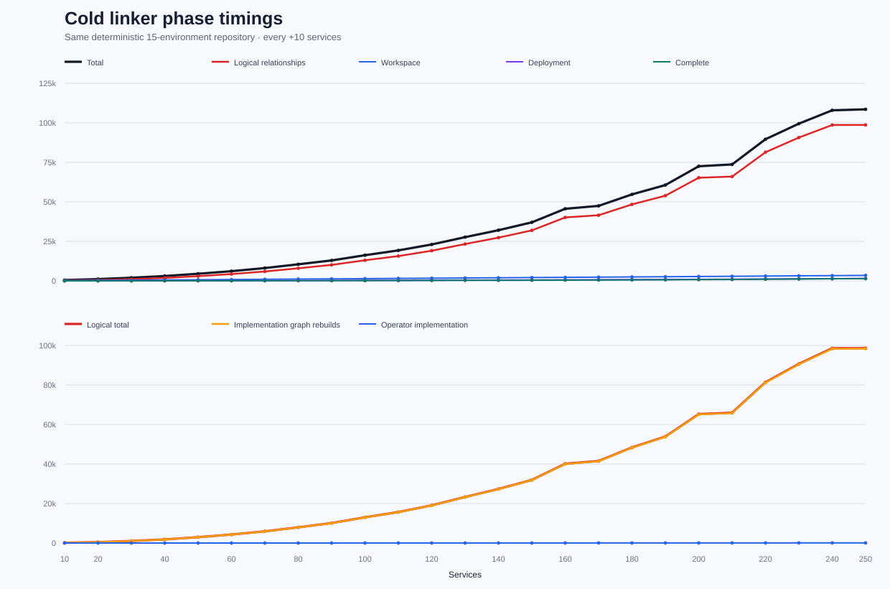
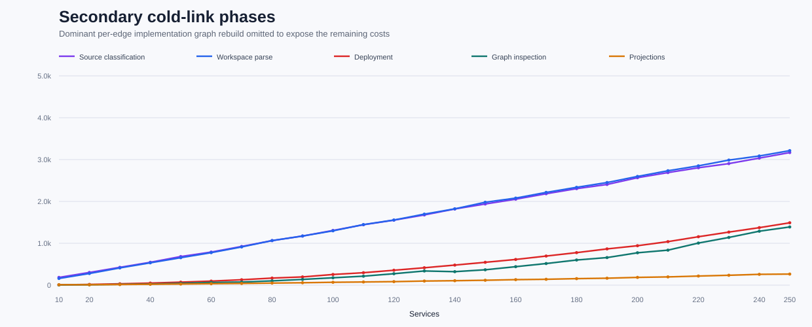

# Linker phase timing report

Generated: 2026-11-22T06:51:25.454Z. Fresh Node.js process per trial; source reads and module loading excluded; profiler is synchronous and opt-in.

Every +10 service point has one phase-profiled run. Control points 10, 80, 140, 180, 210, 220, 250 have three runs and report medians.

## Finding

At 250 services, logical relationship materialization consumes 98658.7 ms (90.9% of 108547.3 ms total). Rebuilding the operator implementation graph consumes 98427.7 ms (90.7% total) across 6454 calls, averaging 15.25 ms per authored relationship.

The hot loop calls `buildIndexedGraph(documents, elements, imports, linkedEdges, typeSystem)` once for every logical relationship before invoking its operator implementation. Each call scans the full project model and an increasingly large accumulated edge list. The measured dominance and the loop structure together explain the superlinear curve: the linker repeatedly reconstructs substantially the same graph. This subphase grows 757.0× for 25× more services; a log-log fit across all 25 points has exponent 2.13, very close to quadratic growth.

Cold link time grows 209.5× while service count grows 25×. The other top-level phases at full scale are: source classification 3167.7 ms, snapshot build 1.3 ms, workspace 3453.3 ms, deployment 1490.1 ms, projections 264.5 ms, completion 1435.4 ms.

Inside logical relationship materialization, the remaining measured work is: graph rebuild 98427.7 ms, endpoint snapshots 90.2 ms, operator implementation 57.1 ms, resolution and bookkeeping 83.6 ms.

## Measurements

| Services | Trials | Total ms | Classify ms | Workspace ms | Deployment ms | Logical ms | Rebuild graph ms | Projection ms | Complete ms |
| ---: | ---: | ---: | ---: | ---: | ---: | ---: | ---: | ---: | ---: |
| 10 | 3 | 518.0 | 184.8 | 170.9 | 7.2 | 135.7 | 130.0 | 9.4 | 7.5 |
| 20 | 1 | 1113.8 | 303.2 | 298.1 | 17.1 | 471.4 | 461.2 | 9.4 | 13.2 |
| 30 | 1 | 1979.9 | 425.4 | 439.1 | 31.9 | 1042.7 | 1027.4 | 14.7 | 24.6 |
| 40 | 1 | 3058.5 | 546.3 | 568.4 | 48.9 | 1838.2 | 1818.4 | 20.9 | 34.2 |
| 50 | 1 | 4500.8 | 683.2 | 696.6 | 71.6 | 2968.2 | 2943.2 | 26.3 | 53.2 |
| 60 | 1 | 6116.8 | 790.2 | 825.5 | 96.4 | 4293.4 | 4262.7 | 34.6 | 75.1 |
| 70 | 1 | 8101.5 | 924.7 | 982.4 | 128.6 | 5936.4 | 5900.7 | 40.6 | 87.0 |
| 80 | 3 | 10476.3 | 1064.1 | 1130.6 | 168.8 | 7944.0 | 7903.3 | 49.3 | 115.8 |
| 90 | 1 | 12936.6 | 1173.5 | 1244.7 | 196.3 | 10111.1 | 10062.9 | 57.4 | 151.8 |
| 100 | 1 | 16229.1 | 1306.9 | 1378.1 | 254.8 | 13026.6 | 12966.1 | 68.3 | 192.7 |
| 110 | 1 | 19286.4 | 1443.4 | 1560.9 | 297.0 | 15674.8 | 15614.3 | 75.6 | 232.8 |
| 120 | 1 | 23035.1 | 1552.3 | 1669.9 | 356.0 | 19078.3 | 19005.0 | 83.7 | 293.2 |
| 130 | 1 | 27661.0 | 1677.4 | 1803.3 | 415.5 | 23304.7 | 23217.7 | 98.0 | 360.1 |
| 140 | 3 | 32059.1 | 1819.5 | 1937.1 | 479.2 | 27355.9 | 27259.8 | 106.2 | 346.2 |
| 150 | 1 | 37039.6 | 1938.9 | 2101.2 | 545.6 | 31941.5 | 31844.5 | 116.8 | 393.6 |
| 160 | 1 | 45618.7 | 2053.6 | 2210.2 | 613.6 | 40138.8 | 40010.7 | 131.4 | 469.1 |
| 170 | 1 | 47444.7 | 2183.6 | 2351.7 | 695.1 | 41524.9 | 41398.7 | 140.0 | 547.5 |
| 180 | 3 | 54726.3 | 2305.4 | 2481.3 | 776.6 | 48377.5 | 48243.6 | 155.3 | 632.9 |
| 190 | 1 | 60626.6 | 2405.4 | 2602.9 | 865.7 | 53892.0 | 53750.8 | 165.7 | 692.7 |
| 200 | 1 | 72519.5 | 2566.7 | 2756.2 | 941.8 | 65257.8 | 65070.8 | 185.3 | 809.5 |
| 210 | 3 | 73667.0 | 2689.4 | 2900.3 | 1039.7 | 65986.3 | 65832.2 | 197.0 | 873.5 |
| 220 | 3 | 89622.6 | 2804.2 | 3027.3 | 1156.6 | 81394.4 | 81193.3 | 217.4 | 1046.2 |
| 230 | 1 | 99482.5 | 2903.9 | 3206.1 | 1267.5 | 90684.6 | 90456.8 | 235.9 | 1182.4 |
| 240 | 1 | 107936.2 | 3035.2 | 3305.2 | 1373.6 | 98626.8 | 98350.0 | 258.4 | 1334.8 |
| 250 | 3 | 108547.3 | 3167.7 | 3453.3 | 1490.1 | 98658.7 | 98427.7 | 264.5 | 1435.4 |

Raw profiler events and call counts are in [raw.json](raw.json); selected phase medians are in [summary.csv](summary.csv).
