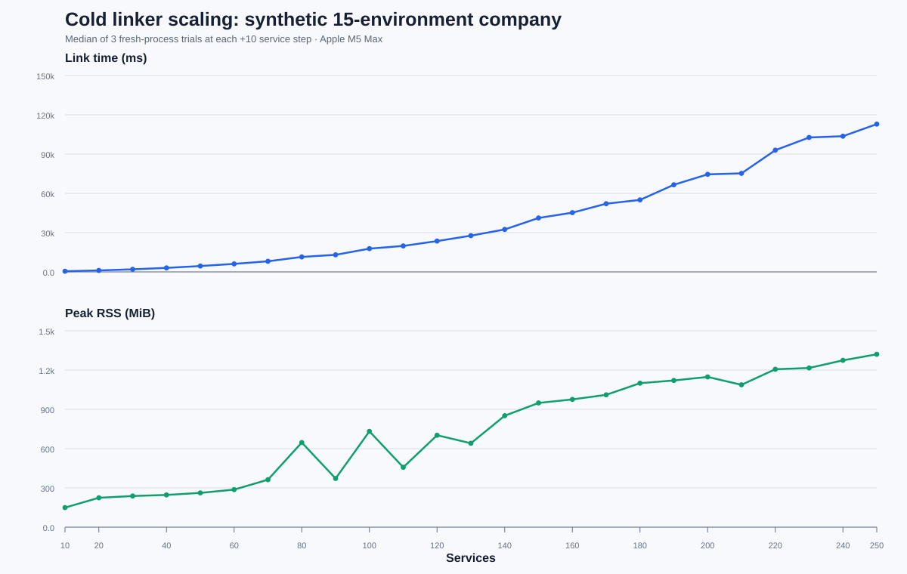

# Cold link scaling results

Generated: 2026-11-22T06:17:20.955Z

Host: Apple M5 Max, 18 logical CPUs, 36.0 GiB RAM, v24.18.0, darwin/arm64.

Each point is the median of 3 independent cold links in fresh Node.js processes. Source files are loaded before timing. Peak RSS includes the language runtime and loaded source strings; the final column subtracts RSS immediately before linking to expose the linker's approximate incremental footprint.

## Summary

- Full scale (250 services): 1016 files, 71,578 lines, 7,590 linked elements, 10,204 linked edges.
- Median cold link time grows from 506.0 ms to 112881.5 ms.
- Median peak RSS grows from 149.5 MiB to 1320.7 MiB.
- Ordinary least-squares slope across all points: 476.66 ms/service and 5.22 MiB/service. Use the plotted curve, not only the slope, to spot nonlinear growth.

## Measurements

| Services | Sources | Elements | Edges | Median link, ms | Peak RSS, MiB | Link RSS delta, MiB |
| ---: | ---: | ---: | ---: | ---: | ---: | ---: |
| 10 | 56 | 390 | 398 | 506.0 | 149.5 | 68.2 |
| 20 | 96 | 690 | 803 | 1115.5 | 224.6 | 142.7 |
| 30 | 136 | 990 | 1213 | 1970.5 | 238.0 | 156.1 |
| 40 | 176 | 1290 | 1623 | 3052.2 | 246.3 | 164.2 |
| 50 | 216 | 1590 | 2030 | 4487.0 | 261.8 | 178.9 |
| 60 | 256 | 1890 | 2438 | 6123.4 | 286.9 | 204.1 |
| 70 | 296 | 2190 | 2848 | 8120.0 | 362.7 | 279.8 |
| 80 | 336 | 2490 | 3256 | 11438.4 | 646.7 | 562.5 |
| 90 | 376 | 2790 | 3666 | 13054.0 | 371.9 | 287.5 |
| 100 | 416 | 3090 | 4073 | 17777.7 | 732.1 | 647.8 |
| 110 | 456 | 3390 | 4483 | 19837.0 | 457.5 | 372.7 |
| 120 | 496 | 3690 | 4892 | 23544.1 | 702.3 | 616.8 |
| 130 | 536 | 3990 | 5301 | 27681.3 | 641.0 | 555.3 |
| 140 | 576 | 4290 | 5708 | 32435.0 | 851.4 | 764.8 |
| 150 | 616 | 4590 | 6117 | 41190.7 | 949.0 | 862.2 |
| 160 | 656 | 4890 | 6526 | 45255.4 | 976.0 | 888.7 |
| 170 | 696 | 5190 | 6936 | 52089.9 | 1011.0 | 922.9 |
| 180 | 736 | 5490 | 7344 | 55001.3 | 1100.0 | 1012.8 |
| 190 | 776 | 5790 | 7751 | 66553.5 | 1120.8 | 1030.8 |
| 200 | 816 | 6090 | 8161 | 74525.4 | 1147.7 | 1057.0 |
| 210 | 856 | 6390 | 8569 | 75276.5 | 1087.5 | 996.4 |
| 220 | 896 | 6690 | 8979 | 92967.6 | 1206.4 | 1114.9 |
| 230 | 936 | 6990 | 9386 | 102690.8 | 1216.3 | 1127.0 |
| 240 | 976 | 7290 | 9794 | 103650.1 | 1274.6 | 1184.4 |
| 250 | 1016 | 7590 | 10204 | 112881.5 | 1320.7 | 1227.1 |

Raw trials are in [raw.json](raw.json); machine-readable medians and ranges are in [summary.csv](summary.csv).
