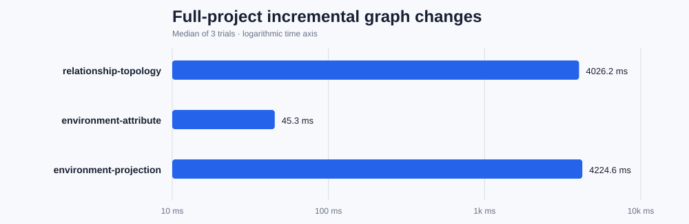

# Incremental graph-change scenarios

Generated: 2026-11-26T06:58:42.416Z

Each scenario edits one source in the full 250-service repository after a cold session has been created. Values are medians of 3 independent processes. The baseline has 1016 sources, 7620 elements, 20764 edges, and 14310 projected edges.

| Scenario | Median, ms | Support sources | Relinked sources | Final edges | Projected edges | Edge delta | Deployment, ms | Projections, ms | Inspection, ms |
| --- | ---: | ---: | ---: | ---: | ---: | ---: | ---: | ---: | ---: |
| relationship-topology | 2217.1 | 1016 | 1 | 20764 | 14310 | +16 / -16 / ~0 | 48.8 | 562.6 | 21.3 |
| environment-attribute | 70.5 | 2 | 1 | 20764 | 14310 | +0 / -0 / ~0 | 0.0 | 0.0 | 0.1 |
| environment-projection | 2734.2 | 1016 | 251 | 20514 | 14060 | +0 / -250 / ~0 | 45.3 | 515.2 | 20.4 |

The attribute scenario changes only environment metadata. Relationship and projection scenarios change graph topology and therefore use the conservative global invalidation path. Raw trials and every recorded phase are in [raw.json](raw.json).
