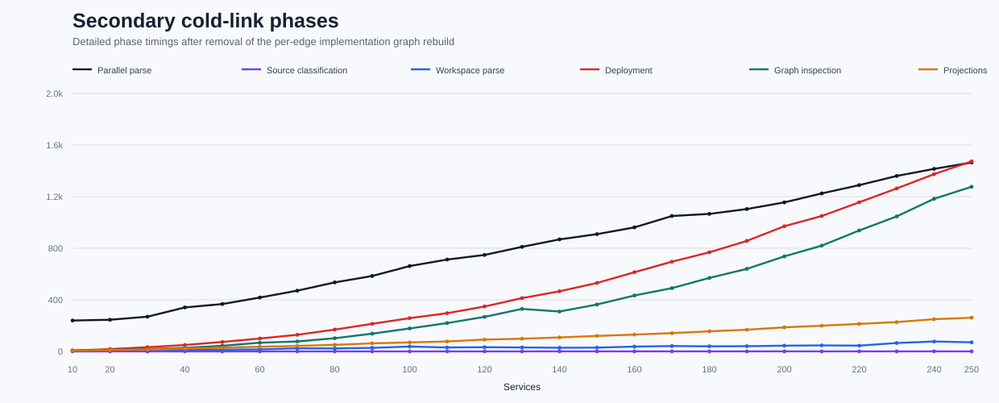

# Linker phase timing report

Generated: 2026-11-24T19:21:22.925Z. Fresh Node.js process per trial; source reads and module loading excluded; profiler is synchronous and opt-in.

Parse mode: parallel, up to 4 workers.

Every +10 service point has one phase-profiled run. Control points 10, 80, 140, 180, 210, 220, 250 have three runs and report medians.

## Finding

At 250 services, logical relationship materialization consumes 84.3 ms (1.7% of 4858.3 ms total). No operator implementation graph is built inside the relationship loop. The indexed graph is built once during completion in 27.0 ms.

Cold link time grows 17.2× while service count grows 25×. The other top-level phases at full scale are: parallel parsing 1455.5 ms, source classification 0.4 ms, snapshot build 1.2 ms, workspace 227.2 ms, deployment 1481.9 ms, projections 258.9 ms, completion 1334.6 ms.

Inside logical relationship materialization, the remaining measured work is: endpoint snapshots 27.2 ms, operator implementation 23.2 ms, resolution and bookkeeping 33.9 ms.

## Measurements

| Services | Trials | Total ms | Parse ms | Classify ms | Workspace ms | Deployment ms | Logical ms | Rebuild graph ms | Projection ms | Complete ms |
| ---: | ---: | ---: | ---: | ---: | ---: | ---: | ---: | ---: | ---: | ---: |
| 10 | 3 | 282.2 | 238.1 | 0.0 | 16.9 | 7.3 | 5.0 | 0.0 | 5.5 | 7.8 |
| 20 | 1 | 339.2 | 245.0 | 0.1 | 40.8 | 17.8 | 8.5 | 0.0 | 10.3 | 15.0 |
| 30 | 1 | 395.3 | 269.5 | 0.1 | 38.5 | 32.6 | 11.9 | 0.0 | 15.6 | 25.3 |
| 40 | 1 | 513.9 | 343.8 | 0.1 | 43.1 | 50.1 | 15.6 | 0.0 | 21.9 | 37.3 |
| 50 | 1 | 610.3 | 365.4 | 0.1 | 64.6 | 74.7 | 18.9 | 0.0 | 28.6 | 56.1 |
| 60 | 1 | 716.9 | 413.5 | 0.1 | 62.2 | 97.2 | 22.3 | 0.0 | 35.7 | 83.9 |
| 70 | 1 | 844.7 | 471.6 | 0.1 | 80.1 | 129.3 | 25.7 | 0.0 | 43.2 | 92.6 |
| 80 | 3 | 989.1 | 527.5 | 0.1 | 91.3 | 167.6 | 28.7 | 0.0 | 51.6 | 121.0 |
| 90 | 1 | 1123.5 | 563.3 | 0.2 | 99.4 | 213.8 | 31.4 | 0.0 | 60.3 | 152.9 |
| 100 | 1 | 1292.9 | 634.2 | 0.2 | 102.7 | 256.4 | 35.4 | 0.0 | 68.3 | 193.4 |
| 110 | 1 | 1453.8 | 674.9 | 0.2 | 109.7 | 306.3 | 38.7 | 0.0 | 77.1 | 244.5 |
| 120 | 1 | 1627.7 | 739.4 | 0.2 | 112.0 | 346.0 | 41.4 | 0.0 | 95.8 | 290.7 |
| 130 | 1 | 1826.5 | 811.2 | 0.2 | 112.6 | 398.0 | 44.8 | 0.0 | 98.2 | 349.6 |
| 140 | 3 | 1935.0 | 848.6 | 0.3 | 118.0 | 463.8 | 47.7 | 0.0 | 106.1 | 339.9 |
| 150 | 1 | 2133.1 | 898.9 | 0.3 | 129.6 | 538.4 | 49.8 | 0.0 | 118.4 | 395.2 |
| 160 | 1 | 2311.1 | 928.6 | 0.2 | 137.5 | 602.1 | 53.2 | 0.0 | 131.8 | 455.1 |
| 170 | 1 | 2587.4 | 1015.2 | 0.3 | 148.9 | 685.2 | 56.9 | 0.0 | 142.5 | 535.7 |
| 180 | 3 | 2809.8 | 1061.5 | 0.3 | 155.5 | 766.4 | 60.6 | 0.0 | 157.3 | 605.3 |
| 190 | 1 | 3054.4 | 1111.2 | 0.3 | 160.9 | 856.9 | 63.6 | 0.0 | 171.8 | 682.8 |
| 200 | 1 | 3316.6 | 1138.6 | 0.3 | 169.1 | 961.9 | 66.4 | 0.0 | 197.7 | 779.7 |
| 210 | 3 | 3576.1 | 1224.4 | 0.4 | 179.8 | 1037.1 | 69.2 | 0.0 | 196.4 | 864.9 |
| 220 | 3 | 3906.8 | 1283.6 | 0.3 | 195.3 | 1160.1 | 75.2 | 0.0 | 212.6 | 978.5 |
| 230 | 1 | 4183.5 | 1316.4 | 0.3 | 196.0 | 1280.1 | 76.6 | 0.0 | 226.4 | 1084.8 |
| 240 | 1 | 4522.2 | 1358.1 | 0.4 | 227.9 | 1400.1 | 81.6 | 0.0 | 244.5 | 1206.5 |
| 250 | 3 | 4858.3 | 1455.5 | 0.4 | 227.2 | 1481.9 | 84.3 | 0.0 | 258.9 | 1334.6 |

Raw profiler events and call counts are in [raw.json](raw.json); selected phase medians are in [summary.csv](summary.csv).
