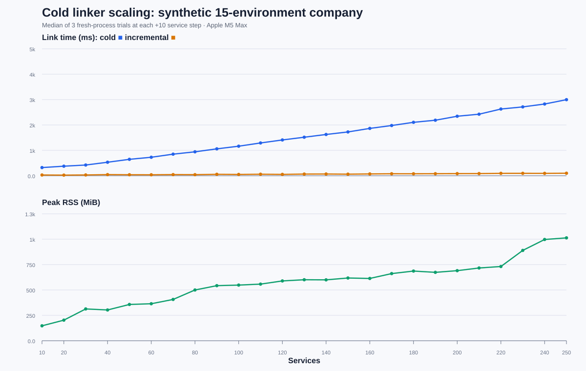

# Cold link scaling results

Generated: 2026-11-24T19:33:08.898Z

Host: Apple M5 Max, 18 logical CPUs, 36.0 GiB RAM, v24.18.0, darwin/arm64.

Each point is the median of 3 independent cold links in fresh Node.js processes followed by one edit to a single component file. Source files are loaded before timing. Peak RSS includes the language runtime and loaded source strings; the final column subtracts RSS immediately before linking to expose the linker's approximate memory footprint.

Parse mode: parallel, up to 4 workers.

## Summary

- Full scale (250 services): 1016 files, 71,578 lines, 7,590 linked elements, 10,204 linked edges.
- Median cold link time grows from 282.7 ms to 4867.5 ms.
- Median one-file incremental link time grows from 26.6 ms to 71.0 ms; at full scale it reparses 1 and relinks 1 source with 13 direct support sources.
- Median peak RSS grows from 142.9 MiB to 965.3 MiB.
- Ordinary least-squares slope across all points: 19.00 ms/service and 2.81 MiB/service. Use the plotted curve, not only the slope, to spot nonlinear growth.

## Measurements

| Services | Sources | Elements | Edges | Median cold link, ms | Median incremental link, ms | Incremental support sources | Peak RSS, MiB | Link RSS delta, MiB |
| ---: | ---: | ---: | ---: | ---: | ---: | ---: | ---: | ---: |
| 10 | 56 | 390 | 398 | 282.7 | 26.6 | 17 | 142.9 | 61.7 |
| 20 | 96 | 690 | 803 | 337.9 | 21.1 | 5 | 199.7 | 117.6 |
| 30 | 136 | 990 | 1213 | 392.6 | 25.7 | 13 | 283.2 | 200.3 |
| 40 | 176 | 1290 | 1623 | 510.1 | 37.4 | 41 | 313.0 | 230.4 |
| 50 | 216 | 1590 | 2030 | 608.6 | 32.8 | 21 | 367.9 | 284.3 |
| 60 | 256 | 1890 | 2438 | 724.9 | 30.2 | 9 | 368.9 | 285.0 |
| 70 | 296 | 2190 | 2848 | 839.3 | 33.8 | 13 | 466.9 | 383.3 |
| 80 | 336 | 2490 | 3256 | 1020.8 | 31.4 | 5 | 461.3 | 376.0 |
| 90 | 376 | 2790 | 3666 | 1140.0 | 44.1 | 33 | 535.0 | 450.3 |
| 100 | 416 | 3090 | 4073 | 1296.5 | 39.0 | 13 | 546.3 | 460.0 |
| 110 | 456 | 3390 | 4483 | 1453.2 | 48.7 | 25 | 571.7 | 486.8 |
| 120 | 496 | 3690 | 4892 | 1655.1 | 39.8 | 5 | 588.7 | 501.1 |
| 130 | 536 | 3990 | 5301 | 1853.0 | 51.4 | 29 | 592.5 | 504.3 |
| 140 | 576 | 4290 | 5708 | 1942.5 | 50.2 | 25 | 606.2 | 520.5 |
| 150 | 616 | 4590 | 6117 | 2152.3 | 45.6 | 5 | 606.4 | 516.6 |
| 160 | 656 | 4890 | 6526 | 2398.0 | 52.4 | 17 | 622.6 | 532.5 |
| 170 | 696 | 5190 | 6936 | 2628.5 | 61.6 | 33 | 630.9 | 540.7 |
| 180 | 736 | 5490 | 7344 | 2842.2 | 58.0 | 21 | 677.7 | 586.6 |
| 190 | 776 | 5790 | 7751 | 3067.3 | 60.2 | 17 | 690.4 | 599.0 |
| 200 | 816 | 6090 | 8161 | 3352.7 | 62.6 | 17 | 719.8 | 631.3 |
| 210 | 856 | 6390 | 8569 | 3644.5 | 60.7 | 9 | 714.0 | 623.7 |
| 220 | 896 | 6690 | 8979 | 3932.0 | 70.3 | 25 | 777.3 | 683.2 |
| 230 | 936 | 6990 | 9386 | 4199.9 | 68.3 | 13 | 877.8 | 786.8 |
| 240 | 976 | 7290 | 9794 | 4608.2 | 68.8 | 9 | 939.2 | 848.3 |
| 250 | 1016 | 7590 | 10204 | 4867.5 | 71.0 | 13 | 965.3 | 869.2 |

Raw trials are in [raw.json](raw.json); machine-readable medians and ranges are in [summary.csv](summary.csv).
